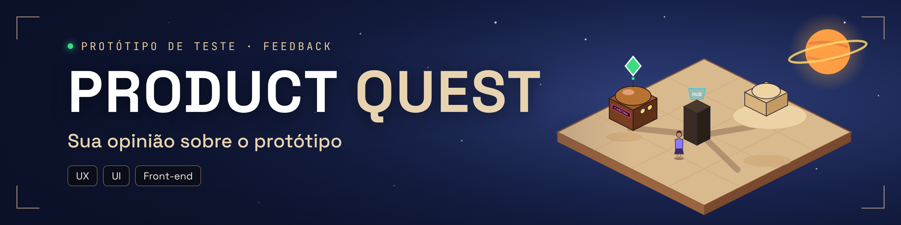
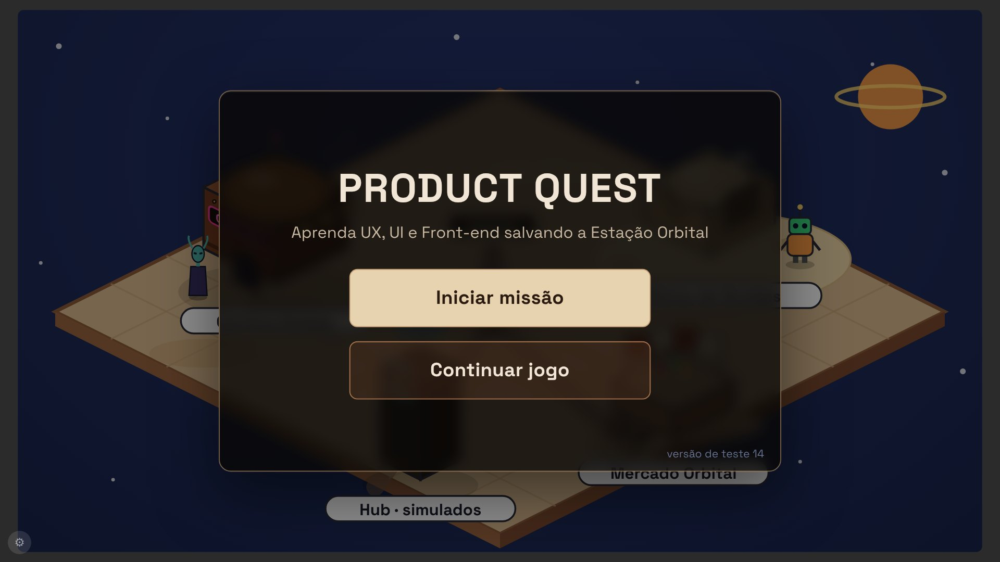
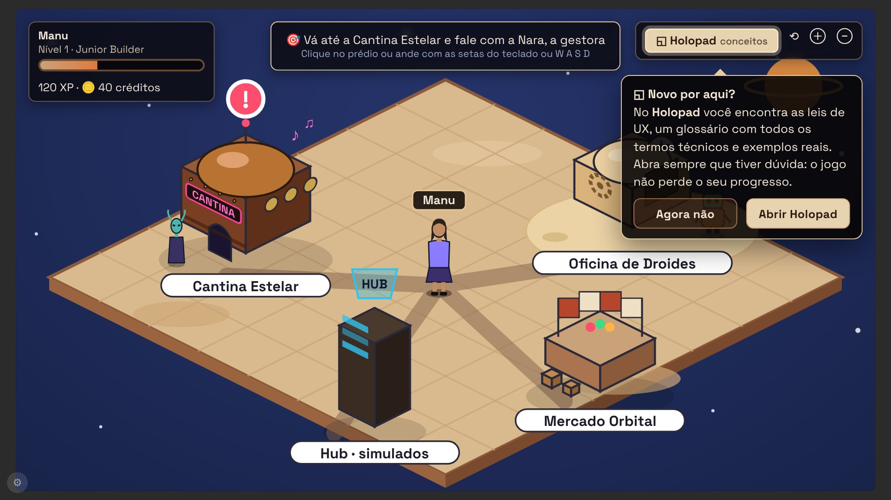
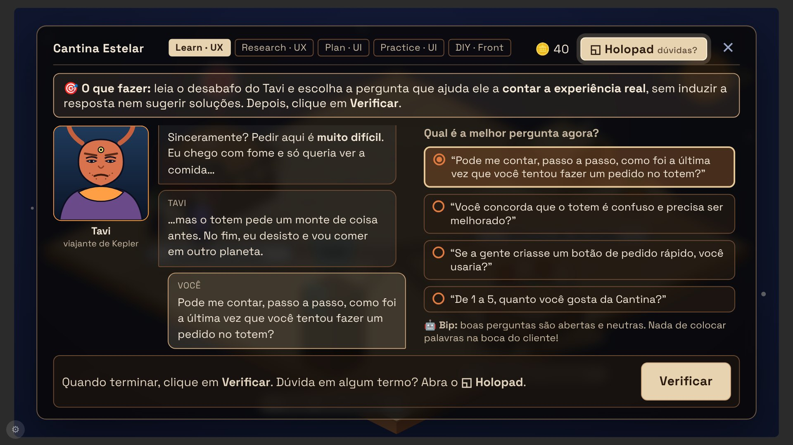
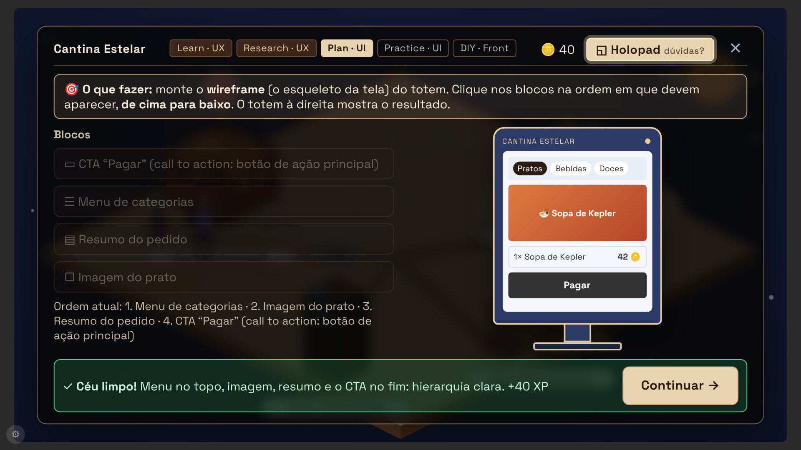
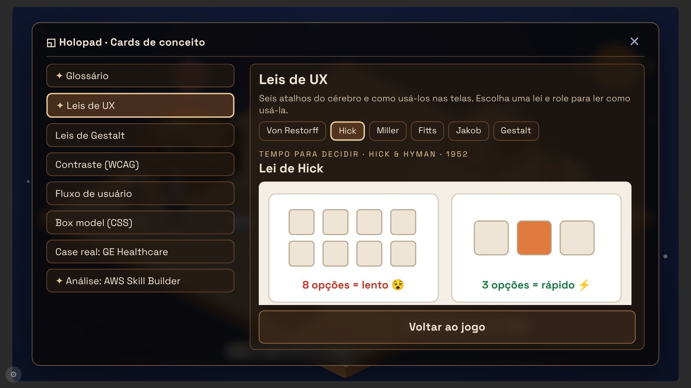
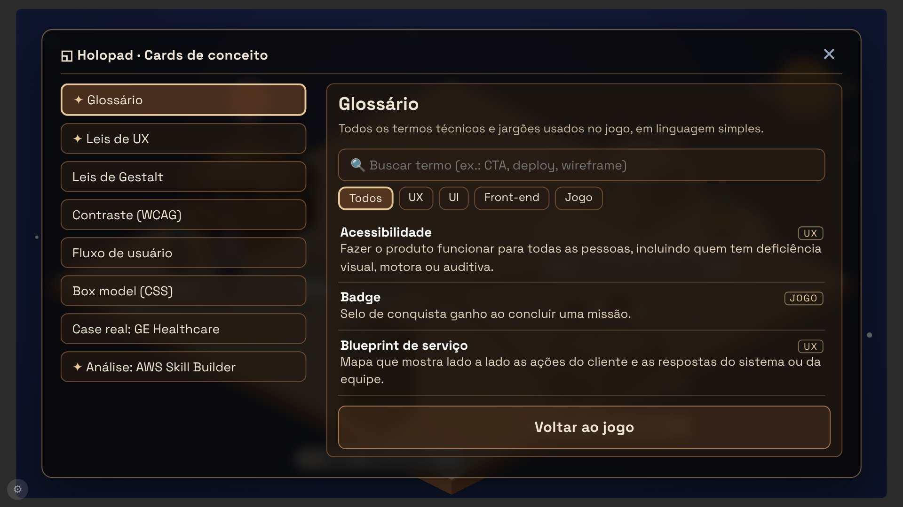
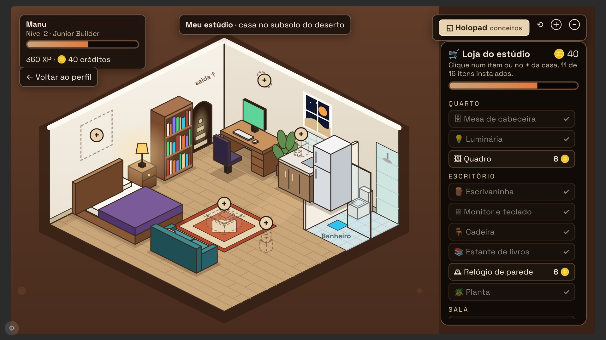
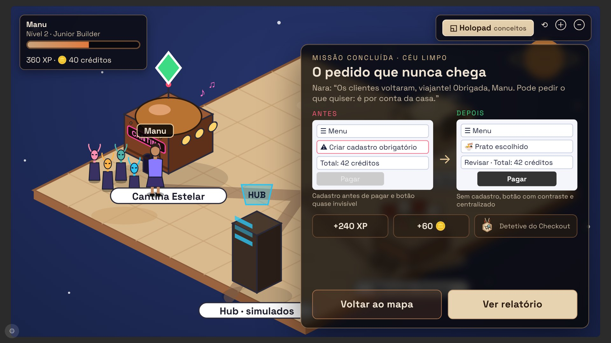

<p align="center">
  
</p>

<p align="center">
  <b>Um jogo para aprender UX, UI e Front-end salvando a Estação Orbital.</b><br>
  Protótipo de teste · v14 · projeto de UX, UI e Front-end de Manuela Crespo
</p>

<p align="center">
  <a href="https://SEU-LINK.vercel.app"><b>▶ Jogar o protótipo</b></a> ·
  <a href="https://www.behance.net/SEU-USUARIO"><b>Estudo de caso no Behance</b></a> ·
  <a href="https://forms.gle/6FN1grZecxYeM5N56"><b>Dar feedback</b></a>
</p>

---

## Sobre o projeto

O **Product Quest** é um jogo educativo para quem está começando ou migrando de carreira para a área de produto. Em vez de assistir aulas, a pessoa aprende **resolvendo um problema real** de ponta a ponta: da pesquisa com usuários até o deploy do código.

Na missão desta versão, os clientes da **Cantina Estelar** começam o pedido no totem de autoatendimento e desistem antes de pagar. O jogador investiga o motivo e corrige o totem em 5 etapas:

| Etapa | Área | O que o jogador faz |
| --- | --- | --- |
| 1. Learn | UX | Entrevista um cliente com perguntas neutras e monta o blueprint do pedido |
| 2. Research | UX | Liga 10 frustrações reais com totens a melhorias de UX (pesquisa desk) |
| 3. Plan | UI | Monta o wireframe da tela do totem na ordem certa |
| 4. Practice | UI | Ajusta cor e espaçamento do CTA até passar no contraste do WCAG |
| 5. DIY | Front-end | Completa o CSS com flexbox, roda os testes e faz o deploy |

A inspiração foi o **AWS Skill Builder** e o **AWS Cloud Quest**: aprender fazendo, com feedback na hora.

## Telas

| Início | Mapa da Estação |
| --- | --- |
|  |  |
| **Learn · entrevista com o cliente** | **Plan · wireframe do totem** |
|  |  |
| **Holopad · Leis de UX** | **Holopad · Glossário** |
|  |  |
| **Estúdio do jogador** | **Missão concluída** |
|  |  |

## Funcionalidades

- **Missão completa em 5 etapas** com feedback explicando cada acerto e cada erro.
- **Holopad**, um caderno de conceitos com:
  - Leis de UX (Von Restorff, Hick, Miller, Fitts, Jakob e Gestalt), com ilustração e exemplo no próprio jogo;
  - glossário com 51 termos técnicos, busca e filtros por área;
  - análise de UX da página inicial do AWS Skill Builder;
  - cards de contraste (WCAG), fluxo de usuário, box model e um case real.
- **Criação de personagem** e escolha de trilha (UX, UI, Front-end ou Product Builder).
- **Estúdio** do jogador: 16 itens em 4 ambientes, comprados com os créditos das missões.
- **Mapa isométrico** navegável por clique ou teclado (setas ou W A S D).
- **Menu da moderadora** (tecla `M`) para pular para qualquer etapa durante testes de usabilidade.
- **Formulário de feedback** ao final da demonstração.

## Decisões de UX

Algumas escolhas do projeto e o princípio por trás de cada uma:

- **Lei de Jakob:** o perfil fica no canto superior esquerdo e o Holopad no direito, como em outros jogos.
- **Lei de Hick:** a escolha de trilha tem só 4 opções, com uma recomendada.
- **Lei de Miller:** a missão é dividida em 5 etapas numeradas, sempre visíveis no topo.
- **Lei de Fitts:** todos os botões têm no mínimo 48 px de altura, e os cards de trilha são clicáveis por inteiro.
- **Efeito Von Restorff:** o Holopad pulsa até a primeira abertura, e o CTA de cada tela é o único botão preenchido.
- **UX writing:** toda a interface é em português, com linguagem simples, e cada erro explica o porquê.

Os estudos que embasaram essas decisões estão em [`docs/`](docs/).

## Tecnologias

- **HTML5** e **CSS3**, com variáveis visuais por tema
- **JavaScript puro** (sem frameworks nem dependências)
- **SVG** desenhado no código para o mapa, os personagens, o estúdio e as ilustrações
- Fontes **Space Grotesk** e **JetBrains Mono** (Google Fonts)
- Deploy na **Vercel**

## Estrutura do repositório

```
product-quest/
├── index.html              # página do jogo
├── css/
│   └── style.css           # estilos e temas
├── js/
│   └── main.js             # lógica, telas e ilustrações SVG
├── assets/
│   ├── img/                # banner, favicon e imagens
│   └── screenshots/        # prints usados neste README
├── docs/                   # estudos de UX que embasaram o projeto
├── CHANGELOG.md            # histórico de versões
├── LICENSE
└── README.md
```

## Como rodar localmente

Não precisa instalar nada.

1. Clone o repositório:
   ```bash
   git clone https://github.com/SEU-USUARIO/product-quest.git
   ```
2. Abra o arquivo `index.html` no navegador.

Se preferir um servidor local, rode `npx serve` na pasta do projeto.

## Testes com usuários

O protótipo foi feito para testes de usabilidade moderados e não moderados:

- Pressione `M` (ou clique no ⚙ no canto inferior esquerdo) para abrir o **menu da moderadora** e ir direto a qualquer etapa.
- Ao final, o jogador é convidado a responder o [formulário de feedback](https://forms.gle/6FN1grZecxYeM5N56).

Os aprendizados de cada rodada de testes estão registrados no [CHANGELOG](CHANGELOG.md).

## Próximos passos

- [ ] Missão da **Oficina de Droides** (foco em Front-end)
- [ ] **Simulado no Hub** com questões de UI
- [ ] Salvar o progresso do jogador
- [ ] Versão para celular
- [ ] Modo acessível (alto contraste e leitura em voz alta)

## Autora

**Manuela Crespo** · UX, UI e Front-end

[LinkedIn](https://www.linkedin.com/in/SEU-PERFIL) · [Behance](https://www.behance.net/SEU-USUARIO)

## Créditos e licença

- Foto do tomógrafo "Adventure Series" usada no card do case real: **GE Healthcare**. A imagem pertence à empresa e é usada apenas para fins educativos.
- A análise do AWS Skill Builder usa a página pública [skillbuilder.aws](https://skillbuilder.aws) como objeto de estudo. AWS é marca da Amazon.com, Inc.
- O código está sob a licença [MIT](LICENSE). Os textos, as ilustrações e os estudos em `docs/` são de autoria de Manuela Crespo.
